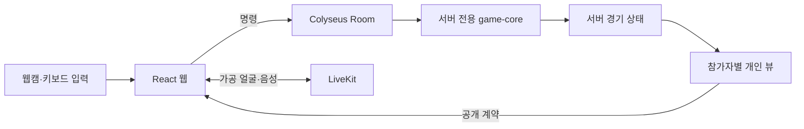

> 기준: 공개 저장소 `main`의 `5caffc1` 스냅샷. 세부 규칙은 연결된 기획서·구현 명세를 따릅니다.

# 까꿍 — 몸으로 움직이는 3D 숨바꼭질

> 웹캠으로 몸과 고개를 움직여 미로를 탐색하는 실시간 멀티플레이 게임입니다.
> 도망자 3명과 술래 3명이 좁은 시야 속에서 3분 동안 탈출과 포획을 겨룹니다.


## 왜 만들었나

까꿍은 키보드 입력을 넘어 몸의 움직임과 가까운 사람의 목소리를 게임 경험에 연결합니다. 좁은 시야, 개인 지도, 제한된 음성 범위로 상대가 어디 있는지 추리하게 하고, 가공된 실제 얼굴로 함께 플레이하는 존재감을 더합니다.

1. 장치를 점검하고 몸의 중립 자세를 보정합니다.
2. 역할별 연습을 거쳐 미로에서 탐색·추적·탈출을 진행합니다.
3. 서버가 이동과 승패를 판정하고 각자에게 보이는 정보만 전달합니다.

| 구분        | 내용                                                         |
| ----------- | ------------------------------------------------------------ |
| 서비스 유형 | PC 웹 기반 1인칭 3D 멀티플레이 숨바꼭질                      |
| 기본 경기   | 6인, 도망자 3명·술래 3명, 180초                              |
| 주요 경험   | 모션 입력, 개인 시야·지도, 술래 장비, 얼굴 합성, 근거리 음성 |
| 아키텍처    | React·R3F 웹 + Colyseus 권위 서버 + LiveKit                  |
| 배포 구성   | 단일 EC2, Docker Compose, nginx, GitLab SSO, Jenkins         |

## 기술 스택

| 영역      | 기술                                             |
| --------- | ------------------------------------------------ |
| Frontend  | React 19, TypeScript, Vite                       |
| 3D 렌더링 | three.js, React Three Fiber, 단일 Canvas         |
| 모션 추론 | MediaPipe Tasks Vision, Web Worker               |
| 게임 서버 | Node.js 24, Colyseus Room, Express               |
| 공개 계약 | TypeScript 공유 패키지, zod, Colyseus Schema     |
| 얼굴·음성 | LiveKit Cloud, WebRTC SFU                        |
| 검증      | Vitest, Playwright, 계약·맵·Cloud·부하 시험 도구 |
| 인프라    | Docker Compose, nginx, Jenkins, AWS EC2          |

## A. 문서 범위

이 문서는 게임의 사용자 흐름, 웹·서버·미디어의 책임, 로컬 실행과 확인 범위를 설명합니다. 세부 제품 규칙은 [기획서](docs/product-spec.md), 요구사항별 구현 상태는 [요구사항 명세서](docs/requirements.md), 승인된 변경은 [결정 정정표](docs/spec/decisions.md)를 기준으로 합니다.

개인 기여는 프론트엔드 게임 UI, 플레이 HUD, 장비 인터랙션, 장치 점검 화면입니다. 아래 권위 서버·미디어·성능 설명은 팀 구조와 팀 측정 결과를 다룹니다.

## B. 목표 서비스 및 구현 정도

### 목표 사용자 흐름

```text
홈 → 방 생성·참가 → 대기실 → 장치 점검·준비
    → 역할별 팀 연습 → 맵 준비·미디어 연결 → 카운트다운
    → 경기 → 결과 → 재경기 또는 로비
```

### 제공 범위

| 영역      | 현재 범위                                          |
| --------- | -------------------------------------------------- |
| 일반 방   | 3:3 멀티플레이                                     |
| 시연 방   | 2:2, 직접 고르는 고정 자리, 발표 재현용 배치       |
| 데모 방   | 운영자 1명과 서버 인형 5명                         |
| 튜토리얼  | 서버 방·LiveKit 없이 혼자 체험                     |
| 모션 조작 | 몸 기울이기·고개 회전·역할별 손동작, 키보드 폴백   |
| 경기      | 이동·포획·장비·지도 교환·개인 출구·승패            |
| 미디어    | 얼굴 가공·합성, 근거리 음성, 서버 발급 권한        |
| 범위 밖   | 미정 도망자 아이템은 MVP 완료 항목에 포함하지 않음 |

데모·시연 방은 등록 이메일 등 입장 조건을 따릅니다. 구현 상태와 실제 Cloud·카메라·다인 접속 검증은 구분하며, 남은 결함은 기획서의 검증 현황·과제 절에서 확인합니다.

## C. 게임 상태 및 데이터 구조

게임의 중심은 관계형 DB ERD보다 **서버의 경기 상태와 참가자별 개인 뷰**입니다.



### 구조의 특징

- `packages/game-core`는 이동·포획·승패·맵 검증을 담당하는 서버 전용 규칙입니다.
- `packages/protocol`은 웹과 서버가 공유하는 전송 계약과 런타임 검증을 담습니다.
- 웹에는 서버 전체 맵·튜닝·비밀을 전달하거나 import하지 않습니다.
- 미디어 권한은 서버가 발급하며 경기 단계와 세대에 따라 관리합니다.

## D. 게임 판정 및 입력 처리 알고리즘

### 서버 판정

서버는 50ms 간격으로 입력을 처리하고 이동·포획·시야·승패를 판정합니다. 참가자에게는 정면 좌우 40도·3.5칸 범위와 벽 가림을 반영한 정보만 보냅니다. 이미 탐색한 영역은 개인 지도에 남습니다.

### 모션 입력

브라우저의 Worker가 얼굴·상체·손동작을 추론해 게임 명령으로 변환합니다. 추론 정지, 유효한 얼굴 소실, 카메라 종료, Worker 오류에는 키보드로 전환하며 모션 복귀 시 다시 보정합니다.

탈출 자세 판정은 브라우저의 입력입니다. 서버는 도전 상태·시간·위치를 검증하며, 카메라 원본을 분석해 자세를 재판정하는 구조로 설명하지 않습니다.

### 정보와 음성 범위

도망자는 서로 지도를 교환할 수 있고, 교환 흔적은 술래에게 단서가 됩니다. 음성은 직선거리가 아닌 벽을 돌아가는 경로 기준 5칸 안에서 들리도록 제어합니다.

## E. 핵심 기능

### 1. 장치 점검과 역할별 연습

카메라·얼굴 추적·중립 자세·입력을 확인한 뒤 역할에 맞는 조작을 연습합니다. 준비 단계와 실제 경기 단계를 구분해 시작 전 상태를 안내합니다.

### 2. 역할별 HUD와 장비

술래는 감지기·덫을 설치해 위치 단서를 얻거나 도망자를 구속합니다. 도망자는 개인 지도·지도 교환·출구 도전 상태를 확인합니다.

### 3. 실제 얼굴과 근거리 음성

브라우저에서 얼굴 윤곽을 잘라 흑백으로 가공하고 아바타에 합성합니다. 대기실에서는 준비 중 가공된 96px JPEG 한 장을 게임 서버를 통해 같은 방에 전달하고, 연습·경기 미디어는 LiveKit 경로를 사용합니다. 원본 카메라 영상과 가공 얼굴 전송을 구분합니다.

### 4. 탈출·포획·재접속

도망자는 자기 출구에서 지정된 팔 자세를 1.2초 유지해 탈출합니다. 경기 중 연결이 끊기면 25초 복귀 유예를 주며, 캐릭터는 제자리에 남아 포획될 수 있습니다. 방 종류별 결과 정책은 기획서를 따릅니다.

## F. AI 기술 활용

### 서비스 기능에서의 AI

MediaPipe Tasks Vision을 브라우저의 동작 인식에 사용합니다. 이는 생성형 AI로 텍스트나 이미지를 만드는 기능과 구분되는 **실시간 비전 추론**입니다. 인식 결과를 입력으로 변환하고 경기 규칙은 권위 서버가 처리합니다.

### 개발 과정에서의 AI

저장소에 [AI 작업 지침](AGENTS.md)이 있으며 코드 경계·검증·보고 규칙을 정합니다. 지침 파일의 존재만으로 특정 기능의 AI 작성 여부나 개인 활용 경험을 단정하지 않습니다.

## G. 실행 방법

### 사전 요구 사항

| 항목        | 버전·조건                      |
| ----------- | ------------------------------ |
| Node.js     | 24.19.0                        |
| pnpm        | 11.19.0                        |
| 제품 체험   | PC 브라우저, 카메라·음성 장치  |
| 실제 미디어 | LiveKit 및 제품 서버 운영 설정 |

저장소 루트에서 실행합니다.

```bash
pnpm install --frozen-lockfile
pnpm setup:env
pnpm exec playwright install chromium
pnpm dev
```

| 주소                                | 용도                    |
| ----------------------------------- | ----------------------- |
| `http://localhost:5173`             | 웹 개발 서버            |
| `http://localhost:2567/health/live` | 게임 서버 헬스 체크     |
| `/play`                             | 제품 화면 진입          |
| `/preview`                          | 렌더링 검수용 합성 장면 |

기본 개발 설정은 미디어가 꺼진 진단 프로필입니다. 개발 빌드의 `/`는 초대 fragment가 없으면 진단 화면을 표시할 수 있습니다.

제품 게임에는 `SERVER_PROFILE=product`, `MEDIA_MODE=livekit`과 LiveKit·운영 설정이 필요합니다. 현재 구현은 `NODE_ENV=production`을 거절하며 제품 배포도 `development`를 사용하므로 임의로 바꾸지 않습니다. 상세 설정은 [인프라 절차](infra/README.md)와 [운영 문서](docs/operations.md)를 따릅니다.

웹 API 기본값은 같은 출처의 `/api`입니다. 직접 지정할 때는 `VITE_API_BASE_URL=http://127.0.0.1:2567/api`처럼 접두사를 포함합니다.

## H. 기타 기록

### 저장소 구조

```text
.
├─ apps/web/            # 화면·3D 장면·입력·Worker·미디어
├─ server/              # 입장·세션·Room·권위 판정·운영 IO
├─ packages/protocol/   # 공개 계약·Schema·검증
├─ packages/game-core/  # 서버 전용 순수 규칙
├─ tests/               # 계약·부하·Cloud·E2E
├─ docs/                # 기획·요구사항·API·구현 명세
├─ infra/
├─ scripts/
└─ Jenkinsfile
```

### 검증 명령과 측정 범위

```bash
pnpm verify
pnpm test:maps
```

`verify`는 포맷·lint·의존 경계·타입·단위/통합·빌드·공개 번들·제품 자산·E2E를 검사합니다. 문서만 바꿀 때는 `pnpm format:check`와 링크·내용 일관성을 확인합니다.

팀 측정 사례는 `maze-v1`·6명·3,600Tick의 코어·투영 조건에서 JSON 전송량 `356 → 56.8 KB/s`입니다. 게임 단독 60클라이언트·30분 부하 기록은 영상·음성을 동시에 켠 검증과 구분합니다. 현재 편집 시점에 이 성능 시험을 다시 실행한 것은 아닙니다.

### 트러블슈팅과 설계에서 확인한 점

| 상황                                     | 대응                                   |
| ---------------------------------------- | -------------------------------------- |
| 카메라·추론 중단                         | 키보드 폴백과 재보정                   |
| 전체 상태 전송으로 정보 노출·전송량 증가 | 서버 상태에서 참가자별 개인 뷰 생성    |
| 발표마다 시작 자리·출구가 바뀜           | 시연 방의 자리·배치 고정               |
| 경기 중 새로고침으로 즉시 무효           | 재접속 유예와 자리 복구                |
| 대기실 미디어가 Cloud 좌석을 선점        | 가공 얼굴 사진과 경기 미디어 경로 분리 |

### 문서와 개선 방향

| 문서                                                                              | 내용                               |
| --------------------------------------------------------------------------------- | ---------------------------------- |
| [기획서](docs/product-spec.md)                                                    | 규칙·검증 현황·남은 결함·결정 질문 |
| [요구사항 명세서](docs/requirements.md)                                           | 요구사항 ID·구현 근거·제외 범위    |
| [API 설계서](docs/api-design.md)                                                  | HTTP·실시간 계약·오류              |
| [웹 구현](docs/impl/web.md) · [서버 구현](docs/impl/server.md)                    | 화면·라우트·Room·입장              |
| [게임 규칙](docs/impl/game-core.md) · [프로토콜](docs/impl/protocol.md)           | 판정·맵·전송 계약                  |
| [미디어](docs/impl/media.md) · [인프라](docs/impl/infra.md)                       | 권한·사용량·배포·시험              |
| [운영](docs/operations.md) · [화면 디자인](docs/design/ui-system.md)              | 장애 대응·UI 규칙                  |
| [협업 컨벤션](docs/collaboration-conventions.md) · [기여 가이드](CONTRIBUTING.md) | 브랜치·커밋·검사                   |
| [제3자 자산](docs/third-party-assets.md)                                          | 모델·SDK 권리와 고지               |

후속 개선은 기획서와 결정 정정표의 현재 범위를 기준으로 진행합니다. 스텁·mock·미정 도망자 아이템을 실제 구현 완료나 Cloud 검증 완료로 집계하지 않습니다.
